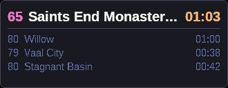
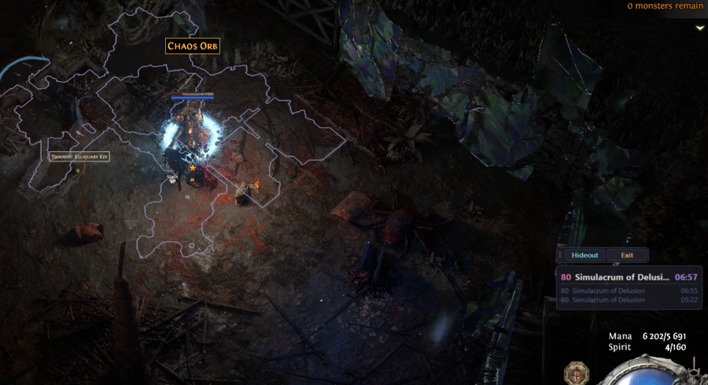
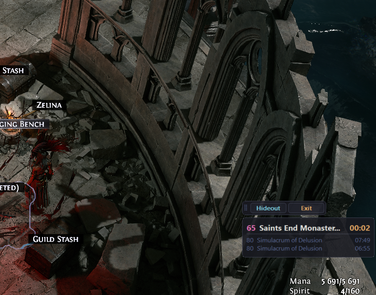
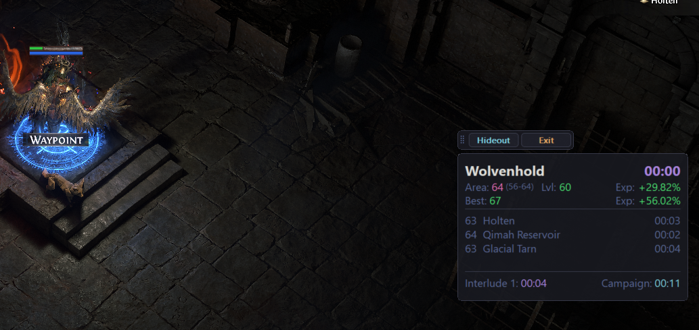
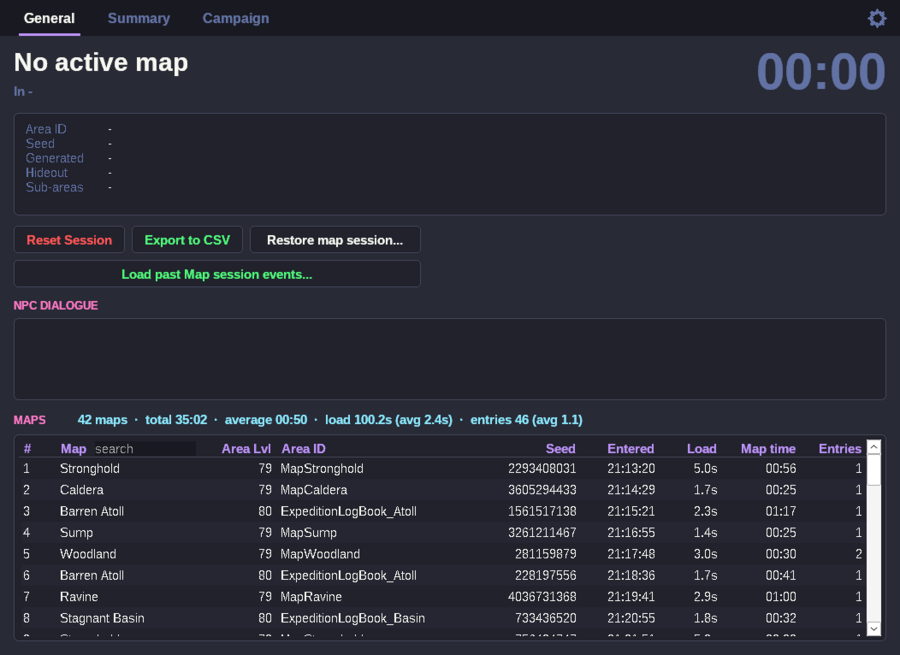
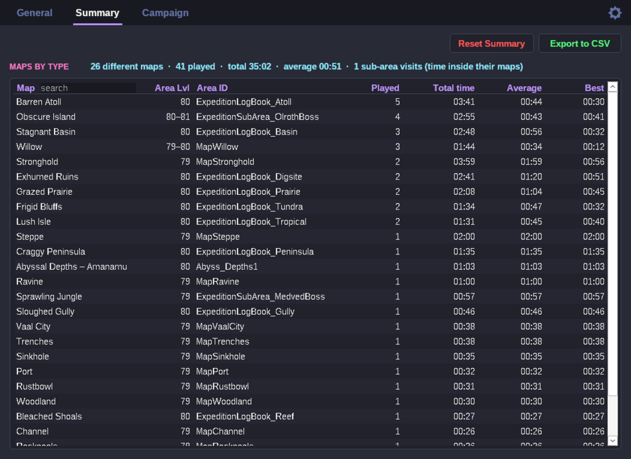
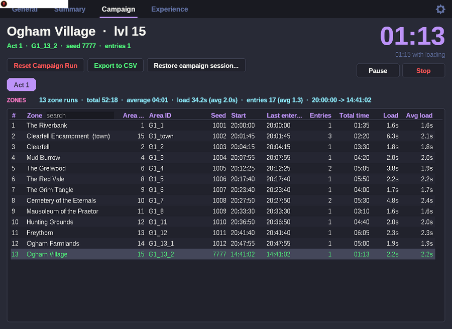
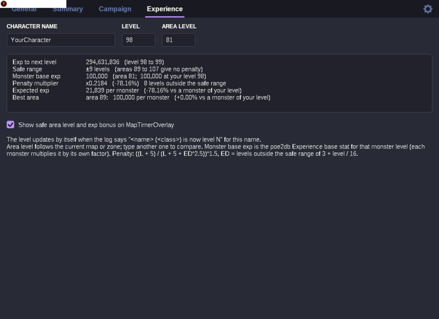
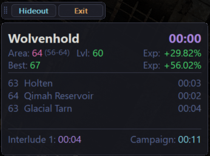

# Poe2 | MapStat

by [Rez](https://github.com/reaz1995)

[](https://buymeacoffee.com/reaz1995)

A small Windows companion for **Path of Exile 2** that times your maps and campaign zones and tracks your experience
by reading the game's log file (`LatestClient.txt`). No game memory reading, no input automation (except the optional
chat-command buttons and hotkeys), nothing sent anywhere - it only reads the log the game writes anyway.



*The timer overlay: a map is running (purple), you go to the hideout (the hideout becomes the header, the paused map
moves to the records, orange), back into the same map (the timer continues), then a new map starts.*

### In game

| In a map | In the hideout | Campaign |
|---|---|---|
|  |  |  |
| timer, area level and exp lines, last maps below | the map you came from waits in the records | zone timer, zone level range, act and campaign time in the footer |

---

## What it does

- **Times every map run** - maps, logbooks, Vaal Ruins, pinnacle arenas, unique maps. Only time spent *inside* the
  map counts; loading screens and hideout visits are tracked separately.
- **Pauses and resumes** - leaving a map pauses it, re-entering the same instance (same area + seed) continues the
  same row, also after a game crash, a relog or an app restart. Generating a new map finishes the previous one.
- **Picks up where you are** - opened while you are already in a map, zone or hideout, it starts tracking right away.
  If you entered less than 15 minutes ago that time counts; after a longer break the current stay starts at 0.
- **Logouts and game restarts** - back in the same map, zone or hideout within 15 minutes, the time away counts as if
  you never left (also when pulling back old data). After a longer break it is not counted and a hideout stay starts
  at 0.
- **Summary per map type** - played, total, average and best time per map; it keeps counting across Maps tab resets,
  restores and imports until you reset it yourself.
- **Sub-areas** - Abyssal Depths (with faction: Amanamu / Kurgal / Ulaman), Lightless Void, Dark Domain and
  Expedition boss arenas count towards the map they were opened from *and* get their own row in Summary.
- **Campaign** - every zone instance has its own timer, grouped by act, with act and total campaign time and load
  times. The campaign timer can be paused, stopped and restarted with buttons or hotkeys (set the keys in Options).
- **Experience** - character level (updated from the log on level up), experience to the next level, the level
  penalty for the current area, expected exp per monster and the best area level to level up in.
- **Layouts** - a gallery of zone and map layout screenshots:
  press a hotkey in game and the game window (or an area you select) is saved to the zone you are in. Pieces of the
  map overlay are joined into one outline per instance.
- **Overlays** - a resizable timer overlay (with optional Safe / Best experience lines) and a command bar
  (`/hideout`, `/exit`). They follow the game window, are shown only while the game is open and not minimized, and
  snap to each other, to the game and to the screen edges.
- **Pull back old data** - rebuild past map sessions from `LatestClient.txt` or the full `Client.txt` (last 24 h,
  7 days, 30 days, everything or a custom date range).
- **Nothing gets lost** - sessions are saved every 10 seconds; every reset starts a new file and the old one can be
  restored. Every list exports to CSV.
- **Lives in the tray** - starts hidden, X and minimize hide it, left-click the tray icon to open it.

## The tabs

| Maps: Session | Maps: Summary | Campaign | Experience |
|---|---|---|---|
|  |  |  |  |

**Maps** has two sub-tabs.

*Session* - the current map (timer, area level, seed, hideout returns, sub-areas) and every map of
the session with load time, map time and entries. Right-click the *Map* header to filter: All / Maps / Expedition /
Special.

*Summary* - one row per map type: played, total, average and best time, area level range. Hover the *Area Lvl*
cell to see the plays per area level. Runs that were generated but never entered are not counted. Summary stands on
its own: Reset Session, Restore map session and Load past Map session events on the Maps tab only add maps to it, each map
instance once. Only **Reset Summary** clears it.

**Campaign** - a *Campaign* pill with the whole run (header shows the campaign time and the time with loading screens, the list shows all zones), then one pill per act (selected automatically), one row per zone instance with its time, entries, load time
and average load per entry. The same zone with the same seed re-entered within 1 h continues its row; towns keep
adding up. Under the big zone timer a smaller one shows the zone time including its loading screens; all other times
(lists, totals, overlay) leave loading screens out.

Campaign timer control (buttons next to the timer, or hotkeys set in Options):

| Action | Default key | What it does |
|---|---|---|
| Stop | not set | ends the run: all times freeze and no zones are tracked until a new run starts |
| Pause / resume | not set | no time is counted while paused; zones you enter are still listed |
| Start | not set | only after Stop: starts a new run from zero (the stopped run stays restorable) |

No hotkeys are set at first: pick them in Options. They work while the game or the app is in front, and the key still reaches the game.

**Experience** - type the character name and level once. The level then follows the log
(`<name> (<class>) is now level 31`). The tab shows:

| Row | Meaning |
|---|---|
| Exp to next level | experience from the current level to the next one |
| Safe range | areas within `3 + level / 16` levels give full experience |
| Monster base exp | Experience base stat for the area level (poe2db monster table); each monster multiplies it by its own factor |
| Effectiveness | *Tablet effectiveness %* + *Map effectiveness %*: every 2% gives 1% more exp (200% = x2), applied to the monster base exp, e.g. `200% | base exp 100,000 -> 200,000` |
| Experience gain | *Tablet exp gain %* (increased experience gain), applied to the exp left after the level penalty, e.g. `50% | exp after penalties 30 -> 45` |
| Penalty multiplier | `((L + 5) / (L + 5 + ED^2.5))^1.5`, ED = levels outside the safe range |
| Expected exp | base exp x effectiveness x penalty x experience gain, and how that compares to a monster of your own level |
| Best area | the area level with the most exp per monster for your level, or a range like `89-99` when several levels give the same, same format |

The area level follows the current map or zone; type another one to compare.

**Layouts** - screenshots of zone layouts, to remember where the exit or the boss was. On the left: Act 1-4,
Interlude 1-3 and Maps, one open at a time, with the zones of that act (zones and maps seen in the log are added).
Click a zone to see its screenshots as thumbnails, newest first. Like in Explorer: click selects a picture,
double-click opens it in the Windows photo viewer, F2 (or double-click on its name) renames it, Enter opens and
Delete moves it to the Recycle Bin; right-click has the same plus *Show in folder*. Pictures dragged onto the tab
are copied into the selected zone (or the zone they are dropped on). *Open folder* opens the folder of the zone.

To take one, press the *Layout screenshot* hotkey (set it in Options) in a zone or map: the whole
game window is saved as `%APPDATA%\Poe2MapStat\layouts\<act>\<zone>\<date>.png` (maps under
`layouts\Maps\<map>`), and a tray notification confirms it. The parts that stay in place on screen are left
out, so they can't make two pieces look alike: the window is cropped (top bar, sides, bottom HUD) and the minimap
corner, the character in the middle and MapStat's own overlays are blanked. With *Select the area* on (Options, next to the hotkey) the Windows snipping tool opens instead
and only the selected area is saved.

**Joined outlines.** The map overlay (Tab) rarely fits on one screen, so take it piece by piece: open the overlay, press the
hotkey, walk on, press it again. A snip that shows the
overlay outline becomes an outline picture: black background, the outline (light blue, or white with HDR) and the
labelled points of interest (Checkpoint, Waypoint, exits) with a ring around their icon (yellow = exit, blue =
checkpoint / waypoint) so they are easy to find on the whole map. Pieces of the same instance (area + seed from the log) are matched where
their outlines overlap and joined into one picture `<date> seed <seed>.png`; a piece that overlaps nothing yet starts
its own picture, and when a later piece links two pictures they become one. Keep the same overlay zoom for all
pieces. The original screenshots are kept in the zone's `pieces\<seed>` folder. Joining takes about a second
and runs in the background. Snips without an outline (or in an unknown
instance) are saved as they are.

All lists: drag a column header left / right to change the column order, right-click it to sort (ascending /
descending / default order) or hide / unhide columns,
type in the search box next to the first column title to filter by name or Area ID (Esc clears). Order, sorting and
hidden columns are remembered; Export to CSV uses the same order.

## Sessions, reset and restore

Everything is saved in `%APPDATA%\Poe2MapStat\sessions\` every 10 seconds and when the app closes, as three files:

| File | Content | Reset with | Restore with |
|---|---|---|---|
| `MapSession <start date>.tsv` | maps of the Maps tab | **Reset Session** | Maps → **Restore map session...** |
| `CampaignSession <start date>.tsv` | campaign zones | **Reset Campaign Run** / **Start** after Stop | Campaign → **Restore campaign session...** |
| `SummarySession <start date>.tsv` | what Summary counts | **Reset Summary** | - |

A reset never deletes anything: the current file keeps the state from before the reset and the app continues in a new
file named with the current date. *Restore* loads any older file of that kind (the current one is saved first), so a
reset can always be undone. Map and campaign data are independent - restoring one never touches the other. Restored
maps are added to Summary.

## Pulling back old data

Maps → **Load past Map session events...** rebuilds the Maps list from the game's logs and adds those maps
to Summary (Campaign is left alone):

| Option | Reads |
|---|---|
| This game session | `LatestClient.txt` (the current game session) |
| Last 24 hours / 7 days / 30 days | `Client.txt` - the game's log of **all** sessions |
| Everything | the whole `Client.txt` |
| Custom range... | pick *From* / *To* in a calendar and any `Client.txt` (e.g. a backup) |

`Client.txt` can be hundreds of MB: it is read line by line on a background thread (the button shows the progress)
and for date ranges the app jumps straight to the start date, so only that part is read. The result goes into a new
`MapSession` file - the previous data stays restorable. Older game versions (0.4 era) without loading-screen lines
are supported too.

## Export to CSV

Every tab has **Export to CSV**: it saves exactly what the list shows (current sorting, filter and search, hidden
columns left out) as a CSV file that opens in Excel / LibreOffice / Google Sheets.

## Overlays

**MapTimerOverlay** - `lvl  area  timer` as header plus the last 0-10 areas (Options → *Recent records*). In the
hideout the hideout is the header and the paused map is the first record. In a sub-area (Abyssal Depths, Lightless
Void, ...) the header shows the sub-area with its own timer; back in the map it shows the map time again, which
includes the time of its sub-areas. In campaign zones a footer shows the
current act and the whole campaign, e.g. `Act 1: 12:40` and `Campaign: 1:05:12`. Zones whose level follows your character level
(Act 2 wilds, Act 4 islands, Interludes) show their range in small print after the level, e.g. `53 (47-52)`.

With *Show safe area level and exp bonus* on (Experience tab), two lines appear under the header (not in hideouts and
campaign towns):

| Line | Meaning |
|---|---|
| `Area: 64 (56-64)  Lvl: 60` | the current area level (moved here from the header, red when it is outside the safe range of 3 + level / 16 levels around you, with the level range in small print for zones that follow your level) and your character level |
| `Best: 67` | the area level with the most exp per monster for your level, or a range when several levels give the same |
| `Exp: +29.82%` | on both lines: expected exp per monster compared to a monster of your own level (green = more, red = less) |

The example is a level 60 character in an Interlude zone of level 64 (range 56-64). On a wide overlay the captions are longer (`Curr. area:`, `Your lvl:`, `Best area:`, `Exp bonus:`). Drag to move, drag the edges to resize (text scales), double-click
to open the app, right-click for the menu.



**Points graph.** *Make graph* (Layouts tab) takes the outlines of the selected zone (one per run) and shows where
its named points were in each run. Each outline keeps the labels found in its screenshots (`Metadata\<seed>\<outline>.txt` in
the zone's folder); points are told apart by their label text (the same text = the same point). Labels seen several times in one
run (Checkpoint) are drawn as small dots. It works in two steps:

1. **Entrances** - named points on the outer edge of the zone (the ways in and out) stay put. The runs are lined up
   on them (on the pair that makes the runs' maps cover the same ground best); a layout the game turned or
   mirrored is recognized from its map walls and turned back; each gets a dot, its label and a ring
   when it is always in the same place.
2. **Places inside** swap between a few spots from run to run. Their points are grouped into spots (numbered grey
   rings), each place is a dot in its own colour, and the legend says which spots it was in (e.g.
   `4/4 runs · spots 1, 3, 4`).

The largest outline is drawn faintly. Saved as `graph <date>.png` in the zone's folder. Outlines made by an older
version are made again from their screenshots in `pieces\<seed>`. Any picture with "graph" in its name counts as a
graph. Tip: zoom the map overlay in a bit (the same zoom each run) so labels are sharper.

**CommandBarOverlay** - *Hideout* and *Exit* buttons that type `/hideout` or `/exit` into the game chat.

**GraphOverlay** - the graph of the zone you are in (or a note that it has none). With several graphs, the arrows
on the left and right page through them; double-click opens the graph in the Windows photo viewer. On its first
start it is placed under the MapTimerOverlay.

**LayoutOverlay** - appears when you take a layout screenshot and shows the outline of the instance you are in as
it stands after that screenshot; it goes away when you enter another instance (or close it from its menu) and comes
back with the next screenshot. Double-click opens the outline picture.

All overlays are left out of screenshots (Windows 10 2004 or later): the layout screenshot, the snipping tool and
other capture tools see the game under them, so they can stay open. On older Windows they are hidden for a moment
while the app takes its screenshot.

**Click-through** (Options, on by default): clicks go through the overlays to the game below. Hold **Alt** to use
them (move, resize, click the buttons, right-click menu).

The overlays stick to the game window: each keeps its distance to the nearest corner of the game, so they follow
when you move the game, resize it or put it on another monitor. While dragging they snap to each other, to the game
edges and to the screen edges.

Timer colours: purple = running, cyan = loading, orange = paused / hideout. Campaign: yellow = paused, red = stopped.

## Options (⚙)

- `LatestClient.txt` path - found automatically on start (running game, Steam libraries, standalone install),
  otherwise you are asked to pick it.
- Always on top, start hidden in tray, overlays on/off, number of overlay records, overlay **Transparency** (0-100%
  in 10% steps, all overlays), **Click-through** (hold Alt to use the overlays). Defaults: not on top, start hidden
  in tray, MapTimerOverlay on with 4 records, CommandBarOverlay off, transparency 10%, click-through on, no hotkeys set,
  check for updates on start.
- **Hotkeys** for the campaign timer and *Layout screenshot* (whole game window, or *Select the area* with the
  snipping tool): click a key, press the new one (Esc cancels, Delete or right-click → Remove sets it to Not set).
- **Theme** - built-in themes (Dark Cyan, Light, Nord) with *Default (Dracula)* at the bottom.
- **Updates** (Release builds) - check on start; the **Check for updates** button next to ⚙ updates and restarts.

## Install

Download `Poe2MapStat.exe` from the [latest release](https://github.com/reaz1995/poe2-mapstat/releases/latest) and run it - no installer, no extra files. On the first start the
window opens; after that the app starts in the tray (icon next to the clock). Only one copy runs at a time.

Windows may show *"Windows protected your PC"* for an unsigned exe from the internet: *More info → Run anyway*.

---

## Build (WSL + llvm-mingw)

```bash
cp .env.example .env            # once: LLVM_MINGW_DIR, DEPLOY_DIR, GITHUB_REPO
cmake -S . -B build             # Release by default; -DCMAKE_BUILD_TYPE=Debug for development
cmake --build build -j          # -> build/Poe2MapStat.exe, copied to DEPLOY_DIR
```

`.env` (git-ignored) holds machine paths and the GitHub repository used for self-update:

| Key | Meaning |
|---|---|
| `LLVM_MINGW_DIR` | root of [llvm-mingw](https://github.com/mstorsjo/llvm-mingw/releases) |
| `DEPLOY_DIR` | folder the exe is copied to after each build (empty = no copy) |
| `GITHUB_REPO` | `owner/repo` for self-update - baked in **only for Release builds**; empty = no updater |

Themes: every `themes/*.yaml` is baked into the exe at build time (`cmake/embed_themes.cmake`). To add one, drop a
`.yaml` into `themes/` and rebuild - see `themes/dracula.yaml` for what each colour is used for.

Linux test tool for the tracker (prints all runs of a log):

```bash
g++ -std=c++20 -O2 -Isrc/core tools/replay.cpp src/core/*.cpp -o replay && ./replay LatestClient.txt
```

### Releasing an update

The version lives in the `VERSION` file (e.g. `1.1.0`); CMake reads it for the app.

1. Change `VERSION` to the new version.
2. Overwrite `CHANGES.md` with what changed in this version (one `- ` line per change).
3. Commit and push to `main`.

`.github/workflows/release.yml` then builds the Release exe on GitHub (llvm-mingw on Linux, `GITHUB_REPO` set to this
repository) and publishes the release `v1.1.0` with `Poe2MapStat.exe` attached and `CHANGES.md` as the release notes (the app shows them when it offers the update; without
`CHANGES.md` GitHub generates notes from the commits).
A push that doesn't change the version does nothing. It can also be started by hand under *Actions → Release → Run
workflow*.

Installed copies find it on start (or with *Check for updates*), download it over HTTPS, check it (exe header, size,
SHA-256 digest from GitHub), replace themselves and restart. The repository must be public.

## Project structure

```
src/core/      tracker, layout outlines and points graph (outline*.cpp), no Windows dependencies (also built on Linux by tools/replay.cpp)
  log_line          parse one log line
  tracker           event dispatch: area changes, loading screens, scenes, level ups, disconnects
  map_tracker       map runs, segments of play time, hideout returns, Maps/Summary resets
  campaign_tracker  campaign zones, acts, Reset Campaign Run, pause / stop
  experience        experience table, safe range, area and penalty multipliers
  area_names        area id -> display name (learned from the log, kept in areas.txt)
  tracker_store     saving / loading MapSession, CampaignSession and SummarySession files
src/shared/    theme parser (YAML subset), GitHub release updater
src/app/       Windows UI
  app.h             shared declarations (state, types, functions of each module)
  main              entry point, window procedure, 0.5 s heartbeat
  log_reader        reading LatestClient.txt, finding it
  sessions          session files, resets, restore
  page_general / page_summary / page_campaign / page_experience / page_layouts   the tabs
  hotkeys           campaign timer and layout screenshot hotkeys (low-level keyboard hook)
  lists / widgets / layout                       list views, owner-drawn controls, page layout
  overlay_timer / overlay_cmdbar / overlay_graph / overlay_common
  import            Load past Map session events (+ custom range dialog)
  theme_ui, tray, csv_export, update_ui, util, state
themes/        built-in themes (baked into the exe)
cmake/         build helpers
VERSION        app version; a new version pushed to main is released by .github/workflows/release.yml
CHANGES.md     release notes of the current version (overwritten for each release)
```

## Data and privacy

`%APPDATA%\Poe2MapStat\` contains `settings.ini`, `areas.txt`, `sessions\` and `layouts\`. Nothing leaves your PC; the only network
access is the optional update check against the GitHub repository the exe was built for. The game logs contain your
character name, chat and IP addresses - they are git-ignored and never uploaded.

## License

[PolyForm Noncommercial 1.0.0](LICENSE) - free to use, share and modify for any noncommercial purpose:

- **Credit the creator** - anyone sharing the app or a modified version must pass on the `Required Notice` lines
  from [LICENSE](LICENSE): "Poe2 | MapStat by Rez - [github.com/reaz1995](https://github.com/reaz1995)".
- **No monetizing** - selling it or using it in a paid product or service needs written permission from the creator.
  Playing with it is personal use.

Path of Exile 2 is a trademark of Grinding Gear Games; this project is not affiliated with or endorsed by them.
